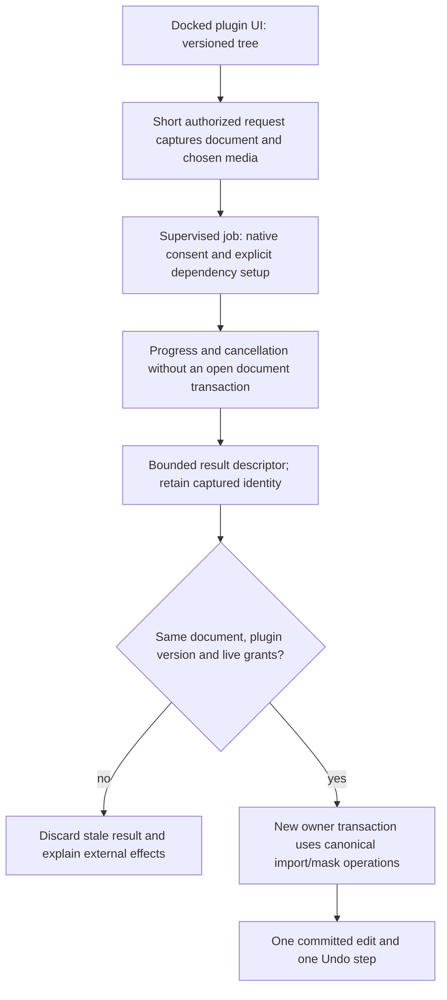

# Community comparison and plugin follow-up backlog

Research started 2026-11-14 at beta revision `74e95e0`. This is a follow-up
backlog, not a claim that the proposed features are implemented. Findings distinguish
observed source, website claims and unavailable evidence.
No third-party plugin code is executed during this review. Recommendations below
are proposals for scoped follow-up work, not approved new APIs.

The expanded [SDK strategy](sdk-strategy-and-capability-roadmap.md) adds PluginCraft,
the pinned public EffectCraft release, Blender/OpenFX and Adobe/product comparisons.
It refines this same backlog rather than creating a second implementation queue.

## Confirmed work

| ID | Priority | Work | Acceptance criteria | Canonical owner |
|---|---|---|---|---|
| UI-DOCK | High | Integrate plugin panels into EffectCraft and PhotoCraft workspaces | Panels can dock and tab beside built-in panels; placement, open state and size survive restart; explicit plugin windows can remain floating; existing guest trees and UI 1.0 continue to work; hidden/disabled panels stop receiving stale input; framework adoption changes the host renderer only. | Each app's workspace adapter; shared UI renders contents. |

FigCraft already has docked plugin panels, saved left/right placement, tabs and
resizable docks in `crates/ui-egui/src/plugin_dock.rs`. EffectCraft currently renders
all plugin surfaces through `PluginUi::window` in `crates/ui-egui/src/plugins_ui.rs`.
PhotoCraft currently wraps all plugin surfaces in `egui::Window` in the same relative
file. This is a host-placement gap, not a need for another guest UI framework.

## Research questions

- Which existing ScriptUI, scripting, CLI, socket or file APIs do community tools use?
- Which capabilities cannot be expressed through the beta's current app contracts?
- How do their panels integrate, persist state and handle callbacks or app restarts?
- How are authors building, packaging, publishing, installing and updating tools?
- Which trust decisions are enforced in code versus stated by the distributor?
- Which advantages should become canonical app operations or author tooling, and
  which require a separately consented native helper?

The evidence notes are [NZO and the related Anonymizer example](community-nzo-review.md)
and [EC Scripts](community-ecscripts-review.md), with a deeper [BOUNCraft release/source follow-up](community-bouncraft-review.md). The [visual comparison](maps/community-capabilities.html)
summarizes selected workflows. Sources were inspected as text, not installed or run.

## Community evidence and tradeoffs

| Source | What is observable | What it does better for the demonstrated use case | Beta advantage and remaining unknowns |
|---|---|---|---|
| Requested NZO Store ArtCraft repository | The requested URL and authenticated repository API return 404. Public account listing/search revealed no confirmed move. | Cannot assess this store's UX or implementation. | No fair security or functionality ranking is possible without its loader/installer. Do not substitute an endpoint or another author's project as the store implementation. |
| Related public Anonymizer source | JSX dockable panel/palette, scheduled polling, local TCP service, Python/model setup, footage paths, sequence import and tracked-mask edits | A deep integrated task, editable results and existing ScriptUI docking; authors can use the app's wider scripting object model. | Beta supplies contribution-scoped live rights, captured document scope, versioned package/UI contracts and managed update/rollback. Anonymizer's inspected local dispatcher has no authentication step; the download function inspected has no digest verification. These are limited source observations, not an audit of every code path or the missing store. |
| EC Scripts deployed registry | One API release, BOUNCraft 2.0; web search/detail/publishing/account client code; upload, scan and submission requests | Richer author-facing submission and discovery UX is visible. | Registry server enforcement is unavailable. Beta has explicit package/digest/signature/freshness enforcement and per-app contract suitability. Website category labels do not prove other apps have working plugins. |
| BOUNCraft release and public source | Downloaded ZIP digest matches the catalogue. JSX uses a dockable panel, host-drawn curve preview, selected properties, expressions, Bake/Remove and persistent presets. Public Python builder writes tiny legacy control-effect Wasm modules. | A focused animation workflow, grouped controls with standard-control fallback and no Rust compilation for the JSX or its handcrafted modules. | Beta lacks selected-property/expression/control-group coverage and private settings. Legacy `ec_*` ABI 1 is not beta `craft_*` ABI 1. The ZIP script differs from the pinned repository bytes; no source-to-release attestation is established. No runtime check was performed. |

Legacy ScriptUI already uses a host renderer for widgets and custom draw lists.
The beta's advantage is the versioned data/event contract, bounded execution and
authorization, not a claim that earlier panels ran arbitrary HTML. Its current
weakness is less app API coverage and more author migration/build work. A signed
catalogue proves correspondence to approved bytes, not absence of malicious behavior.

EC Scripts client-side scan gating and displayed SHA-256 do not establish server-side
scan enforcement or client verification of downloads. Conversely, the beta currently
lacks its visible account/submission/review UI. Those registry experiences are distinct
from plugin runtime capabilities and may remain separate product decisions.

## What the beta already supplies

The beta is a shared package, store, permission model, Wasm/native runtime and UI
contract, with one adapter per app. Existing community scripts can instead use an
app's older scripting object model and a separately installed helper. A website or
store listing does not establish which runtime the downloaded tool actually uses.

| App | Current strengths | Important limits when migrating community tools |
|---|---|---|
| EffectCraft | Composition/layer creation, effects, numeric properties and keyframes, markers, tools, overlays and non-destructive raster effects | No picked-media import/export, render-job initiation, tracked-mask creation or expression-text setter in the beta contract. ScriptUI docking exists in the legacy host, while beta panels currently float. Numeric property calls do not provide arbitrary script execution. |
| PhotoCraft | Pixel reads/writes, bounded histograms, selections, layer masks, canonical filters, picked-file import/export | Filters bake pixels; no persistent smart-filter instance. RGB filter restrictions and bounded memory apply. Earlier file publications may remain after event failure. Beta panels float. |
| FigCraft | Nodes, vector booleans, text/layout, styles, variables, components, SVG export, docked panels | No raster.filter dispatch or raw-path image access. It cannot host a raster plugin merely because a manifest lists FigCraft. |

See the [capability reference](capabilities.md) and generated app contracts for the
actual operation names and permissions. Native helper consent permits external OS
activity; it does not add missing operations to an app adapter. A full-access native
helper can invoke installed CLI programs externally under the user's OS account;
those calls are outside the plugin host-call permission boundary and do not inherit
its single-transaction Undo guarantee. Wrapping an existing JSX script in a package
does not turn legacy scripting into sandboxed Wasm.

## Prioritized work and acceptance

Priority is an integration recommendation, not a schedule or build authorization.
Ship a narrow vertical workflow with evidence before widening the contract.

| ID | Priority / type | Add or improve | Acceptance and boundary |
|---|---|---|---|
| PUBLIC-COMPAT | P0, public migration | Explicit disposition for released extension capabilities | Public EC v0.24.1 has legacy Wasm ABI 1/2, docked ScriptUI, a native effect helper protocol and richer native render services. Inventory affected packages/projects; choose a tested compatibility path or author port; preserve unknown state and report unsupported cases. Beta protocol/ABI version 1 does not mean the old version 1 is accepted. Do not remove temporal/native effect capability silently. |
| UI-DOCK | P0, confirmed integration gap | Workspace docking in EffectCraft and PhotoCraft | Use the acceptance criteria above. Reuse the shared renderer inside the host's actual dock; preserve floating windows as a separate surface kind. Exercise focus, keyboard shortcuts, resizing, closing/reopening, revocation and saved layouts. |
| UI-LIFECYCLE | P0, consistency | Explicit surface lifecycle, errors and state preservation | Report a rejected fifth FigCraft window rather than successful silent loss. Document stop without dispose; any future close/visibility callbacks must avoid re-entrant edits and late replies. A closed surface stays closed; hidden dock tabs preserve local values without receiving invisible gestures. |
| MIGRATION | P0, author workflow | A legacy-to-beta compatibility checklist and real port | Classify each JSX/object-model call as supported, needs a new scoped operation, or intentionally native-only. Port one existing workflow with docked controls and one Undo, without treating JSX or an older Wasm module as beta-compatible bytes. Keep the legacy path usable while a port is incomplete. |
| MOTION | P1, EffectCraft capability | Selected-property workflows, key editing and deliberate expression support | Use the inspected BOUNCraft workflow as a design case. Numeric sample baking can use existing property/key operations, but selected-property queries, key deletion and expression editing are absent. Define timeline scope, units, key metadata and Undo; keep expression evaluation under the canonical engine's own limits and validation rather than adding a general script-evaluation host call. |
| CONTROL-GROUPS | P1, EffectCraft design | Parameter-only controls for animation tools | BOUNCraft stores expression inputs in tiny pass-through legacy effects or standard controls. Decide a canonical parameter-group/contribution strategy with animatable values, persistence and missing-plugin behavior. Avoid forcing motion controls into the raster-filter abstraction or adding a universal new API before a real port needs it. |
| JOBS | P1, new contract design | Asynchronous jobs with progress, cancellation and result import | Start/acknowledge within the event deadline; run computation without holding a document transaction; open a new owner transaction when applying results. Revalidate plugin version, live grants, document epoch and target IDs. Revocation stops supervision and rejects stale results. Do not increase event timeouts to hide long inference. |
| MEDIA | P1, app capability | Picked media exchange for EffectCraft; common handle semantics where useful | Add canonical app operations for chosen source data, sequence import and output destinations. Define source-versus-rendered frame semantics, ranges, color/alpha, quotas and cancellation. Keep paths out of Wasm, validate decode dimensions before allocation and make partial external effects explicit. Reuse PhotoCraft's handle lessons without claiming its implementation already exists in the other apps. |
| TRACKED-MASKS | P1, EffectCraft capability | Import generated mask tracks and derived sequences | After MEDIA/JOBS, demonstrate an anonymization workflow with canonical mask creation and frame/key interpolation, bounded point counts and one apply/Undo transaction. Preserve existing effects, timing and project references. An overlay is not an editable document mask. |
| SETTINGS | P1, author usability | Private plugin preferences with schema and quotas | Separate app-local preferences, portable project state and temporary job data. Namespace by plugin/app, preserve newer state on downgrade, validate schema and define uninstall/export/reset behavior. Never expose the app's entire settings file or use plugin management calls as guest operations. |
| PROJECT-DATA | P1, persistence | Versioned document-owned plugin payloads and stable references | Save without a plugin, reopen and save again, reinstall, and recover data. Distinguish opaque state, parameters, external assets and caches. Define quotas, migration ownership and identity across delete/recreate, Undo and document replacement; never execute saved payloads as code. |
| AUDIO-TIMELINE | P1, app domains | Bounded audio analysis and exact time/edit plans | Auto Beat Marker requires audio-envelope data and marker edits; a future FilmCraft multicam workflow needs tracks/clips, linked A/V and rational frame/sample times. Add canonical per-app operations and preview/apply/Undo; reject stale plans and protected-track edits. This is not generic menu-command execution. |
| TYPED-CONTRACTS | P1, SDK foundation | Structured schemas and generated ergonomic bindings | Current OpSpec args/results are example strings. Migrate a bounded operation family to canonical structured types, units, limits, errors and versions; prove schema/dispatch agreement. Then generate docs and language wrappers without a parallel hand-edited API catalogue. |
| AUTHOR-TOOLS | P1, build and debugging | Easier scaffolds, capability checks and a migration harness | Expand current effect/panel/data scaffolds deliberately for command/tool/event/native cases. Provide multi-app examples, per-operation errors, logs, UI inspector and package validation. Keep manifest/contract definitions authoritative; avoid a second hand-maintained schema. Validate behavior against all declared apps, not only package structure. |
| NATIVE-SETUP | P1, install usability | Reproducible native helper/dependency setup | Prefer platform-packaged helpers; inventory external runtimes, models, license and disk/network costs. Hash downloaded data/models, stage atomically and explain retries/uninstall. No silent shell installer in Wasm or catalogue installation. Re-consent for a changed native version; handle offline/cancelled setup without enabling a broken contribution. |
| DISCOVERY | P1, distribution UX | Richer package pages and suitability signals | Show real screenshots, versioned docs/changelog, app/platform/contract support, permissions/reasons, native label, setup requirements and known limits. Give actionable compatibility failures. Listing quality, GitHub stars and identity tiers must not be presented as a code audit or a sandbox. |
| SERVICES | P2, separate design | Narrow Wasm network/clipboard services where justified | Decide concrete use cases before implementing existing permission vocabulary. Bound payloads/time, mediate destination/origin and user intent, and enforce declared/live grants on every call. Keep arbitrary sockets, paths, processes and engine command dispatch out of Wasm. Full-access native remains a distinct choice. |
| FRAMEWORK-THEMES | P2, existing deferral | Activate framework theme/font integration | Use the canonical framework Engine/parser/store and semantic appearance tokens. Guests keep versioned trees and component fallbacks. Test focus, repeated render passes, accessibility and scaling; do not let plugin CSS or backend probes control the app. |
| RENDER-DEPTH | P1 for public regression; P2 for advanced additions | Temporal/region/native effects and future persistent PhotoCraft filters | Public EC already has neighbor-frame Wasm ABI 2 and native helper effects; beta defers them. Define input/time/padding/color/concurrency/cache/resource semantics, then test clip edges, subframes, out-of-order rendering and helper loss. Native OS access alone supplies no host render transport. New GPU/3D or PC smart-filter support needs its own host design. FigCraft still has no raster.filter dispatch. |

## How an advanced native-assisted workflow should fit

This is a proposed architecture for follow-up work, not a description of APIs that
already exist. UI, jobs and final document edits have separate owners.

Do not send source paths or full rendered buffers merely because a native helper
has OS access. Choose the intended privacy boundary and obtain the corresponding
user decision. Native consent describes what the OS allows; app-host operations
still describe what the adapter mediates. A process group helps stop children but
is not OS confinement.

## Delivery slices

1. Docking and explicit surface refusal, with a docked existing example in both apps.
2. Inventory one real community port, implement the narrow motion/settings operations
   it needs, and then demonstrate the complete workflow. Record any remaining omissions.
3. One supervised native job using chosen media, visible progress/cancel and a
   fresh result-apply transaction. Then add tracked-mask import if that port needs it.
4. Private settings, setup diagnostics and richer catalogue pages.
5. New services and render-depth features only after their concrete app designs.

The future framework change must remain host-owned throughout these slices. Adding
an author API that depends on egui widgets, arbitrary HTML or framework internals
would undermine the compatibility already supplied by the beta.
