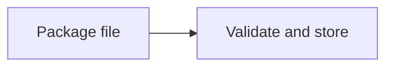
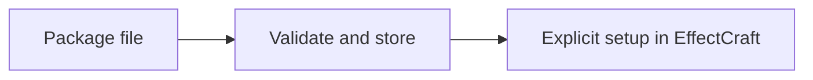
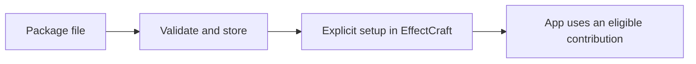

# How the Craft plugin system works

Recorded 2026-11-12. This explains the confirmed target design and its staged delivery. It is not a claim that the platform is implemented. Read the [current decisions](post-call-reconciliation.md#current-understanding-after-the-first-pass) and [architecture correction register](architecture-review-2026-11-12.md) alongside it.

The existing local code at `a6c5fae` contains `craft-ext-core` and `craft-ext-store`. It validates schema-1 packages, extracts files, records installations and app enablement, and loads theme data. It has no shared executable plugin host, permission brokers, generated SDK, catalogue verifier, or integrated app adapters. The newer behavior below is planned unless explicitly identified as existing code. The [open-PR evidence](../sources/architecture-review-2026-11-12/pr-4.json) describes proposed changes, not merged functionality.

## Start with the person installing a package

A package is the file the person installs. It can provide several contributions: a preset collection, a transform, or later a command or panel. Installing that file and allowing one app to use its contents are separate actions.

Import checks archive bounds, names, manifest structure, declared contents, sizes, hashes, and compatibility information. The host assigns provenance; the package cannot declare itself official. Import executes no plugin code and enables nothing. A malformed package is refused without replacing working state. Retaining the verified manifest and archive identity is additional P1 work, not a property of today's extractor.

Setup chooses contributions and records required permissions for that package in EffectCraft. Optional permissions start unavailable. Shared files may be visible to another compatible app, but that app gets no enablement or grant from this setup.

At use, shared eligibility checks the selected release, compatibility, setup, grants, machine policy, known revocations, and source continuity. The app then uses a data importer or invokes the shared host. The intended single eligibility path prevents the GUI, CLI, and renderer from making different permission decisions. See [architecture sections 3–4](../architecture.md#3-vocabulary-and-lifetimes) and [P1's eligibility model](../implementation/P1-store.md).

## What L0, L1, and L2 mean

| App support | Person's action | What executes | App's responsibility |
|---|---|---|---|
| L0 data packages | Install and select supported data such as presets or LUTs | A bounded app/host importer; no plugin program | Validate the data, integrate it into real controls, preserve settings and report incompatible kinds |
| L1 transforms | Apply an effect, filter, generator, or supported function | A bounded WebAssembly transform over typed input/output | Prepare correct input, run the host, check output, integrate undo/rendering, save references, and fail output truthfully |
| L2 session plugins | Run a command, edit through a panel, use a pointer tool, or create a plugin object | A session instance calling approved app operations and brokers | Enforce caller identity and scope, manage transactions/jobs/UI lifetimes, and preserve project state |

Native helpers are a separate execution route. Their process separation contains some failures but does not confine malicious code running as the user's account.

Compiled and runtime describe different steps. An author compiles a WebAssembly plugin before distributing it; the app loads and runs that module later through the planned wasmi host. Import does not compile arbitrary publisher source or execute install scripts. A native author instead supplies an OS/CPU-specific executable that the app supervises as a separate process. The app itself is compiled with its adapter. A downloaded plugin cannot supply missing host-side contract implementations.

The first usable MVP is EffectCraft with one L0 data package and one L1 transform, including save/reopen and failure handling. Exact examples remain deferred. This selection does not mean every L0 data kind, every transform contract, or all later operations ship in that first workflow. The detailed first-slice dependency graph still needs reconciliation. See [P5](../implementation/P5-management.md), [P6](../implementation/P6-effectcraft.md), and the [correction register](architecture-review-2026-11-12.md).

## What each component owns

Names other than the existing two crates are the planned module layout, not a list of available APIs.

| Component | Responsibility | Does not own |
|---|---|---|
| `craft-ext-core`, existing foundation | Package parsing, IDs, versions, file inventory, tiers; planned contribution/contracts/permission vocabulary and eligibility data | App documents or execution |
| `craft-ext-store`, existing foundation | Staging, installed files, atomic state and app setup; planned release records, grants, effective selections, leases and safe cleanup | App undo/rendering or arbitrary guest code |
| Operations kit, planned | Invocation identity, typed operation descriptors, authorization, transactions, jobs, errors, origin tracking and effect reporting | Each app's document model |
| Contracts, planned | Shared domain request/result definitions, versions, supported formats and limits | Whether an app implements them correctly |
| Runtime host, planned | Module admission, link/import policy, instances, budgets, cancellation, output boundaries and later native supervision | App-specific image/color/history semantics |
| Conformance/reference host, planned | Contract fixtures, hostile modules, reproducibility checks and adapter proof | A substitute for real-app integration tests |
| Guest SDK and generators, planned | Typed bindings, declarations, parameter metadata, templates and author conveniences | Trust decisions or the author's algorithm |
| Author CLI `craft-ext`, planned | Create/check/test/dev/pack/verify/prepare-release | Publishing without the author's action |
| Management actions, planned | One install/setup/grant/update/remove workflow used by GUI and CLI | A second store or a separate policy implementation |
| Shared egui manager, planned | Host-drawn management, consent, compatibility, diagnostics and repair UI | Plugin-defined permission prompts |
| Embedded app `plugin` CLI, planned | Management and headless fixture access using the same actions | The authoring CLI's build/release role |
| Per-app adapter, planned | Contract offers, conversions, registry hooks, undo, persistence, render/export, jobs, menu placements and integration tests | Duplicated package validators or shared sandbox logic |
| Catalogue client/publisher, planned | Authenticated metadata, pinned downloads, publication holds, transfers and incidents | Hosting plugin binaries or granting execution rights |

These are libraries and app integrations. The design does not introduce a required launcher process or a background store daemon. Shared files and shared code let independently running apps cooperate. Their synchronization rules therefore matter as much as the in-process type definitions. See [system map](../architecture.md#5-system-map).

## Applying an L1 transform

The user adds the contribution through the app's normal editing workflow. The app records an undoable change. When rendering, the adapter resolves the exact eligible release and holds its files through a lease.

The adapter prepares contract input, including dimensions, pixel layout, parameters, quality, and declared render context. It must convert color and alpha honestly. An app cannot claim a shared raster contract merely because it can pass a byte buffer.

The host admits the module under one engine profile, supplies only allowed imports, allocates bounded buffers, and runs with fuel and memory limits. The planned raster v1 transform has no imports. It returns data through the typed contract, not through unrestricted file or network access.

The host and adapter validate sizes, formats, values, and ownership before accepting output. A trap, invalid output, cancellation, or exhausted budget cannot silently become successful final output. Preview may display a labelled fallback; export must report failure. A valid result enters the app's ordinary cache and render path.

The contract still needs precise instance reset, allocation/deallocation, working-color identity, and deterministic-state rules. Rejecting nonfinite output alone does not prove an arbitrary guest produces the same finite result on every call. These are [review items AR10–AR12](architecture-review-2026-11-12.md), not implemented guarantees. See [P3](../implementation/P3-host.md), [P4](../implementation/P4-contracts-sdk.md), and [P6](../implementation/P6-effectcraft.md).

Stateful processing and instance reuse are separate questions. Parameters and authored data can persist in a project without a live guest instance. Scratch caches may survive calls only without changing their meaning. A temporal effect may intentionally consume previous state and produce next state; that needs an explicit contract for seeking, ordering, isolation and cancellation. Even a fresh guest instance can execute such an effect when the host passes its previous state explicitly. The user asked to [discuss these distinctions first](architecture-review-2026-11-12.md#stateful-transforms-distinctions-for-discussion); no fresh-state rule or stateful raster contract is approved yet.

## Commands, panels, and permission checks in L2

The app owns the native window, event/frame loop, document, history and egui context. A plugin describes controls or bounded canvas drawing; the adapter places those contributions into host-owned menus, inspectors, docking and tools. Callbacks produce requests under plugin authority. The app validates and applies edits, then redraws from app state. Plugin code does not become an in-process egui library, open arbitrary trusted permission windows, or replace the app's document model. Stable widget IDs, event ordering, stale-response handling and canvas accessibility remain detailed UI contracts in the existing [system guide](../system-guide.md).

An invocation records who is asking and the captured scope. A plugin invocation stays a plugin invocation through nested operations. Sharing the same operation handler with the user CLI does not give a plugin the CLI user's authority.

The intended operation path is:

1. Find a typed descriptor and check exposure for this caller.
2. Parse bounded arguments and resolve actual targets without side effects.
3. Check the operation's marking, required access, captured targets, current grant, and machine policy.
4. Check availability and run inside the app-owned transaction.
5. Commit or roll back the document, publish events, and report any separately executed external effects.

Management, protected-core, and internal operations are unavailable as public plugin calls. Built-in features remain under app control. Ordinary exposed operations can still refuse access because a plugin's grant is narrower than the human user's authority.

Permissions belong to a package within one app. Contribution enablement is a presentation choice, not an isolation boundary. Contributions sharing a runtime and memory cannot be assigned fictional independent security identities. Authors needing stronger separation use separate packages.

Optional access can be requested only through an eligible user-started GUI action and a host-owned prompt. A user gesture must be represented separately from the plugin principal. The current P2 sketch incorrectly permits consent only for a human principal; that requires correction without promoting the plugin's authority. CLI/render/headless jobs never open prompts. See [permissions](../architecture.md#8-permissions-and-consent) and [AR06](architecture-review-2026-11-12.md).

Long jobs capture revisions, do work off the editing thread, and revalidate before committing. Pointer tools have begin/update/commit/cancel lifetimes; Escape cancels the gesture without retaining half an edit. Panel closure and document switches dispose or cancel the corresponding session work. The exact authorization rules for created objects, related objects, and dynamic batch references remain open.

## Save, reopen, bake, and export

Projects store contribution identity, release/version information, contract versions, parameters, and versioned plugin state. They never carry machine grants. A project is not an installer and opening it does not approve code.

On reopen, the app resolves a compatible installed release or creates a placeholder. The placeholder preserves data and explains whether the contribution is absent, disabled, incompatible, blocked, or from a removed system. A plugin-defined document object may also have a saved fallback preview. Unsupported objects stay preserved rather than being silently deleted.

Repair is deliberate. The person installs or selects a release, sets it up in the app, and grants required access. Migration works on preserved state and must leave the original intact on failure. The planned raster ABI does not yet define the promised migration callback; v1 state support must be scoped or that interface specified.

Final output must refuse missing or failing processing that the render actually requires. The architecture's phrase "any missing plugin" needs refinement: baking keeps a disabled original, so that archived original cannot also prevent exporting the baked result. Required render dependencies and reversible un-bake behavior remain a design item, with an end-to-end bake/remove/export case to prove it.

Export writes temporary output and publishes the final name only after success. Mid-export traps and cancellation must not leave a finished-looking file. Image sequences need a defined cleanup/publication strategy too. See [project model](../architecture.md#16-projects-and-reliable-output) and [P6 E6–E10](../implementation/P6-effectcraft.md).

## Update, disable, remove, and cleanup

An update first installs a new immutable release beside the old one. Every update asks. Setup carries forward eligible existing choices, but new contributions begin disabled. Broader permissions, changed ownership, or native access cannot inherit approval silently.

An app needs both a desired release policy and an unambiguous effective release. If it follows the package default but cannot accept the new default yet, it continues using its previous effective release. The proposed state format does not express that transition fully; the correction register records it.

The user confirmed on 2026-11-12 that cleanup retains all referenced releases: package defaults, per-app effective selections and pins, pending-consent references, required dependency releases, and live jobs. A job lease protects files during execution; a setup reference protects files between executions. They serve different lifetimes.

Selection, lease acquisition, retention calculation, and deletion need one coherent synchronization protocol. An OS-locked guard is useful evidence that a process is alive; it does not by itself prevent another process deleting the release before the guard is registered. Uncertain liveness must prevent unsafe deletion rather than being treated as an empty live set.

Disable affects one app and preserves its grants. Global uninstall removes setups and grants and eventually removes bytes after references/leases are released. An app-scoped manager must distinguish "disable in this app" from "uninstall everywhere" before changing another app's state. Shared settings/private-storage deletion and active dependency handling still need exact ownership rules. See [store lifecycle](../architecture.md#11-store-and-lifecycle) and [P1](../implementation/P1-store.md).

## Distribution and incident response

For the manual MVP, the person imports a local package. It receives a truthful host-assigned label and still undergoes validation and the same runtime restrictions. Local import is possible offline when its required files are already present. Offline does not make a previously known revoked digest acceptable.

For later catalogue delivery, an author explicitly uploads a compiled package to a GitHub Release and proposes metadata. Checking covers the exact artifact and record. The baseline policy includes first-listing/risk review, two maintainers for every native listing/release, and a 48-hour hold for bot-merged routine updates. PC05 and PC07 were deferred; this review changes neither baseline.

A protected publication job authenticates catalogue content through TUF metadata. Maintainers hold signing authority; publishers do not each need a separate signing key. GitHub Pages initially serves metadata. Package binaries remain on authors' GitHub Releases.

The client verifies trusted metadata versions, signatures, freshness, and the selected target's hash before importing downloaded bytes. TUF supplies update authenticity, not a proof that a plugin is harmless. Package inspection, runtime enforcement, and native consent remain separate. The [TUF specification](https://theupdateframework.github.io/specification/latest/) defines its trusted metadata and target-verification protocol.

Listing identity includes stable source and owner information. A rename can preserve continuity; an ownership transfer requires a reviewed transition and renewed acceptance. Initial namespace proof and later signed transfers must fit together without renaming stable package IDs.

Incident severities are advisory, block-new, and disable. Known restrictions must survive ordinary restart/setup repair. Cached metadata supports browsing offline; expired metadata cannot newly authorize listed installs. The exact merge/lifting rules, concurrent refresh handling, complete-machine rollback limits, and cross-process runtime observation bounds still need contracts. Revocation cannot undo data a native program already changed. See [catalogue](../architecture.md#12-distribution-and-catalogue), [incidents](../architecture.md#13-authenticity-and-incidents), and [P7](../implementation/P7-catalogue.md).

## What plugin authors build

An author implements behavior. Generators create bindings and repetitive declarations, not algorithms or app integration.

The proposed workflow is create a template, declare package metadata and per-app requirements, implement typed contributions, test the algorithm, test the contract in a reference host, and test through real app fixtures. `dev` uses an isolated store and grants, then supports diagnostics and reload through an authenticated app attachment.

`pack` combines metadata and module descriptors into a deterministic archive. `verify` checks the artifact. `prepare-release` runs the relevant checks and reports removed contributions, changed state, and wider authority. The author performs publication explicitly. Catalogue review concerns the exact proposed release.

The authoring plan currently covers the raster transform template more clearly than L0 data packages. It also needs one descriptor schema, a tracked build-input contract for `Craft.toml`, a per-app contract aggregation rule, resource delivery for dependency-using transforms, and a state migration interface. The [author/adapter findings](architecture-review-2026-11-12.md) identify these gaps. A data dependency being installed does not automatically make its contents available inside an import-free guest.

## What app maintainers build

Each app implements one adapter in its own repository. It exports supported contracts and typed operation inventories, supplies conversions, integrates contributions into its real menus/registry/rendering, and owns document/undo/job behavior.

A starter generator and checklist can expose missing hooks. They cannot prove that color conversion, cancellation, undo, project preservation, or headless parity works. A shared contract becomes advertised only after that app's conformance passes.

The planned cutover initially lands support code dormant, then wires the new adapter and removes the old plugin system in a coordinated change. Old-system project data opens as placeholders. Industry-format native hosts are an explicitly retained exception. Native helpers removed at EffectCraft cutover are unavailable until their planned P10 replacement unless the user changes that delivery consequence.

The platform team and the first three app maintainers develop EffectCraft, FigCraft, and PhotoCraft integration together; later adapters belong to their app teams. Names, exact PR contents, other-app L0 rollout, and some cutover boundaries remain open. See [adapters](../architecture.md#21-app-adapters).

## Additional workflows and boundaries

These cases supplement the main journeys. The [forty-scenario coverage map](workflow-coverage-2026-11-12.md) links every existing scenario to this explanation and the relevant unresolved contracts.

| Workflow | Intended behavior and limit |
|---|---|
| Conflicting names, formats and shortcuts | IDs and reserved namespaces prevent claiming built-in identity. A duplicate importer/exporter is an explicit alternative; the built-in stays default until the user chooses otherwise. Shortcut suggestions apply only to free chords; plugin installation cannot replace core or user bindings |
| One package across several apps | Shared bytes do not imply shared grants, state or document semantics. Unsupported contributions have explicit reasons. A transform can share an unchanged module only where each app implements the matching contract; sessions remain app-specific |
| Theme and translation packages | Bounded data import runs no code. Themes are explicitly selected and checked against app token/contrast rules. Translation packs cannot replace trusted permission/warning text. Richer token schema remains separate work |
| Large resources and models | Setup offers download timing and displays sizes. Referenced bytes have size/digest/licence/readiness rules; interrupted downloads and low disk need recoverable outcomes. Shared blobs need reference/lease ownership before deletion. None of this creates unrestricted guest file access |
| Workflow packages | Installation is data import. Execution is an explicit job under the package's declared authority. Missing nodes/resources remain explainable. Host-directed workflow execution and future plugin-to-plugin calls still need a precise authority boundary |
| Temporal, GPU and audio | Reset/seeking, neighboring frames, GPU device loss and audio deadlines need their own negotiated contracts. A raster MVP does not imply those contracts exist. Host GPU operations are separate from later guest shaders. Industry native formats retain their full-access treatment |
| Development and setup portability | Development stores/grants stay separate. Setup export includes package choices/settings but not grants or picker tokens. Import on another machine asks for access again; copied configuration cannot silently grant authority |
| Safe startup and diagnosis | A failed load can offer startup with plugins off. The manager and preserved project data remain available. Diagnostics are bounded and private; support upload is an explicit user-reviewed action. Bisect and cost displays are later planned features, not prerequisites assumed delivered today |
| Catalogue search and popularity | Compatibility and query relevance filter results; official precedence applies within relevance tiers. Dated repository stars are advisory ranking information, never runtime trust. Cached built-in search suggestions keep queries local |
| Paid/private assets and licences | Public catalogue packages follow the selected MIT/Apache policy with allowlisted bundled materials. Local files retain the approved broader licence treatment. Account sign-ins and entitlement/private distribution are not first-release features; old scenario suggestions do not add them |

## What is delivered at each stage

Unit numbers group related engineering work. They are not a strictly linear release checklist. Dependencies cross unit boundaries, and the MVP needs a smaller reconciled activation graph.

| Unit | What is built | Proof needed before depending on it |
|---|---|---|
| P0 | Ownership, existing-consumer audit, schema/deployment decisions, shared-CI coordination | Named accountable owners and a known old-writer boundary; completed PR #1/#3 docs are not repeated |
| P1 | Immutable verified releases, state evolution, per-app setup/grants, eligibility, source identity, retention/leases | Crash/concurrency/frozen-writer refusal and all-references-retained cases |
| P2 | Principals, typed operations, authorization, transactions, jobs, inventories and broker interfaces | Denial before effects, preserved nested identity, rollback and management protection |
| P3 | Runtime admission, engine limits, resource accounting, cancellation, host traits and hostile suites | Real execution under malicious input on each claimed target, not compilation alone |
| P4 | Raster contract/ABI, guest SDK, author tools, reproducible package examples | Contract behavior, pack/verify, cross-platform/context/state checks; unsafe ABI exception remains a decision |
| P5 | Shared actions, egui manager, embedded CLI, bounded data importers and recovery UI | Local lifecycle, GUI/CLI agreement, accessibility, safe-mode and consent behavior |
| P5b | App-owned L0 adapters and reusable starter/checklist | The selected app's supported data kind actually installs and works; other-app timing remains open |
| P6 | EffectCraft invocation migration, unloadable registry, project/render/export hooks, authenticated attach, adapter/cutover | Complete selected L0/L1 workflow, failure/reopen proof, baseline parity and safe legacy removal |
| P7 | Catalogue records, TUF client, pinned downloader, checks/publication/hold, revocations | Authenticated exact artifacts, expiry/rollback/swap refusal and persisted incident behavior; feature milestone PC04 remains deferred |
| P8 | FigCraft L2 sessions, panels/tools/objects and required broker implementations | Real scoped edits, gesture cancellation, host UI and headless behavior; broker implementation ownership needs a task |
| P9 | PhotoCraft shared raster adapter and smart-filter/project integration | Same reviewed module with equivalent contract inputs, honest color handling, persistence and export failure |
| P10 | Native protocol, supervisor, full-access consent and native release enforcement | Bounded framing, crash/hang handling, termination scope and two distinct maintainers per listing/release |
| P11 | Remaining app adapters, richer temporal/audio work where justified, theme adoption | App-specific contract/real-time/persistence proofs; shared tokens integrate when their contract is ready |
| P12 | Outside review, policy/author docs, key recovery rehearsals, live authenticated catalogue and launch decision | Maintainers accept completed evidence and record public launch; Pages suffices initially, custom domain later |

The [unit index](../implementation/README.md) and [main plan](../implementation-plan.md) contain the existing detailed tasks. Current tables miss some cutover gates and have whole-unit arrows that appear cyclic. The correction register treats those as planning defects rather than permission to skip protections or activate a partial app workflow.

## Safety claims and their limits

Package validation prevents malformed archives crossing the import boundary. It does not prove algorithms are safe. A hash binds bytes to an authenticated record; a label and GitHub stars do not supply authority.

The WebAssembly host restricts imports and guest resources. Broker implementations must also bound their own allocations, blocking I/O, credentials, destinations and file handles. Guest fuel does not bound all host work. [Wasmi's limiter interface](https://docs.rs/wasmi/2.0.0/wasmi/trait.ResourceLimiter.html) concerns engine resources; the application still needs its complete host resource budget.

Document transactions protect undoable app edits before commit. Files, uploads, and other external effects need separately reported outcomes and retry rules. An outbox delays effects; it cannot make an already-completed external operation undoable.

Revocation needs observation, cancellation and final authorization checks at defined points. An import-free transform has no host call at which to stop. Cross-process polling introduces a delay. The current architecture and plans need one honest contract covering those cases.

Native helpers can access what the user's account can access until effective OS confinement is implemented. Separate processes, review, labels and consent do not prove protection from malicious native code. Existing two-maintainer native review and outside platform review before public launch remain approved.

No runtime, benchmark, hostile-module, concurrency, or security certification was executed for this walkthrough. The review establishes documentary contradictions and source-derived risks. Implementations must supply the behavioral evidence described by their contracts.
