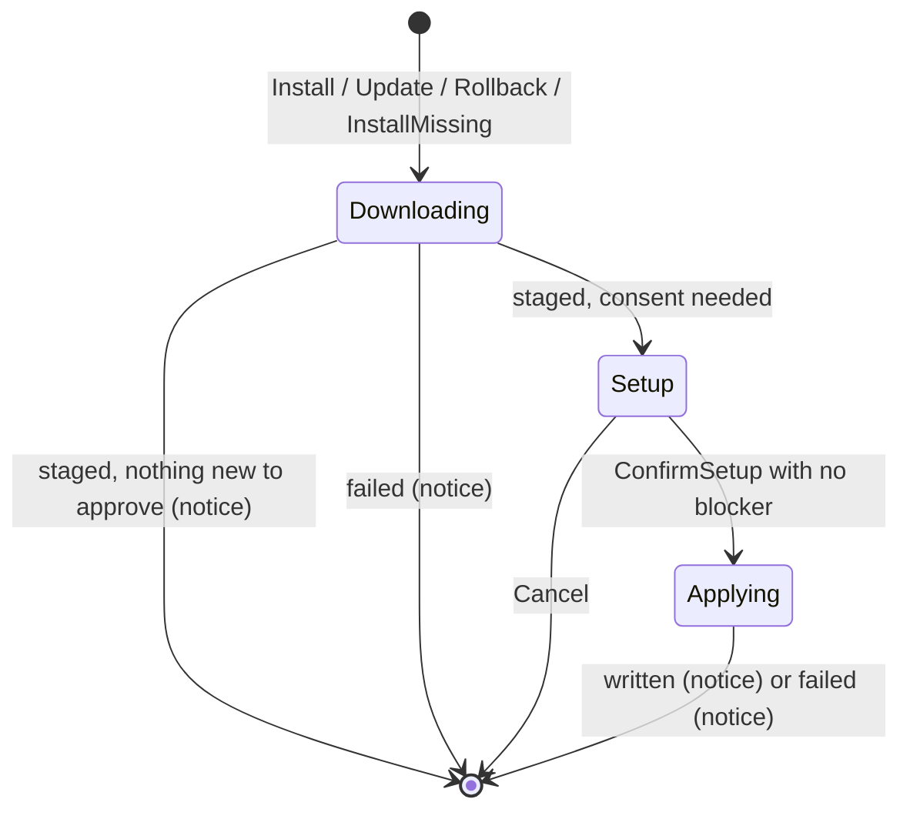

# Plugin Manager model for app and launcher integrators

`craft-ext-manager` (crate `crates/ext-manager`) is the one Plugin Manager model that every app and
the launcher draw. It holds no UI toolkit: it owns the tabs, search, filters, details, install and
update flows, setup consent, problems and English words. Each app draws it with its own widgets
(egui today, the craft framework later) and translates its words through its own i18n.

Status: implemented and unit-tested in source (`cargo test -p craft-ext-manager` drives the real worker
against a temporary store and a signed test catalogue). PhotoCraft draws it with the craft framework
(`crates/ext-ui-fw`); EffectCraft, FigCraft and the launcher draw it with egui (`crates/ext-ui`). See
[Hosting](#hosting).

## Shape

| Type | What it is |
|---|---|
| `Config` | Store root, the apps to manage (`AppTarget { app, provided }`), platform, catalogue base. One app is an app's manager; several apps is the launcher. |
| `Model` | The state a UI draws. `apply(Action) -> Vec<Effect>` changes it; `poll() -> Vec<Effect>` takes worker results. |
| `Snapshot` | What the worker loaded: store state, the verified index, installed manifests, update rows. Replaced whole, never edited. |
| `Tab` | `Discover`, `Installed`, `Updates`, `Problems`, with counts from `count(tab)`. |
| `Query` | Search text, `Filters` (app, category, tier, kind, installed, has update) and `Sort` (relevance, popular, recently updated, name). |
| `Row` | One list card: name, summary, vendor, tier, badges, icon, categories, installed and update versions, downloads, and the `Primary` button. |
| `Detail` | The selected plugin: listing fields, versions with changelog and attestation, permissions with plain sentences and the author's reasons, per-app panels (active, pending, pin, contributions, grants, full access, quarantine), native warning, badges, report URL. |
| `Flow` | One install, update, rollback or install-missing run: `Step::Working(word)` or `Step::Setup(setup)`. |
| `Setup` | The consent sheet: contributions, permissions (required ones marked), warnings, native warning and full-access consent, and `blocker()`. |
| `Problem` | App, plugin, version, `ProblemKind` and an optional `Fix`. |
| `Word` | A stable key and its English text, listed in `WORDS`. |

The data shape comes first because three consumers (each app, the launcher and tests) must agree on
it. Everything a UI shows is a plain value it can compare, so the tests assert literal rows,
problems and setup sheets rather than widget output.

## Wiring

```rust
let config = craft_ext_manager::Config::app(store_root, app_id, provided, platform);
let mut model = craft_ext_manager::Model::new(config);

for effect in model.poll() { handle(effect); }
draw(model.tab(), model.rows(), model.problems(), model.detail());
if let Some(setup) = model.setup(&id) { draw_setup(setup); }
for effect in model.apply(Action::Install { id, app: None }) { handle(effect); }
```

The launcher passes every app it manages to `Config::new`. Actions that change one app's setup
name the app; `Install` picks the first managed app the plugin supports when none is given.

Notices name the plugin (`Notice.subject`, its listing or manifest name) and carry its id
(`Notice.plugin`) for views that match results to rows.

| Effect | What the UI does |
|---|---|
| `Changed` | Redraw. |
| `OpenSetup(id)` / `CloseSetup(id)` | Show or hide the consent sheet for `model.setup(&id)`. |
| `OpenUrl(url)` | Open the browser (the report form). |
| `Notice(n)` | Show a toast: `n.word` (translated), `n.subject`, `n.detail`; `n.error` picks the tone. |

Request repaints while `model.busy()` is true, so worker results arrive without input.

## Threads and cost

One worker thread (`std::thread`, two `mpsc` channels) does every disk, network and signature step:
reading `store-v2.json`, verifying `catalogue/index.signed`, reading installed manifests, refreshing
the catalogue, fetching package files and media, installing, writing consent and checking updates.
It handles jobs in order.

- The worker reloads the snapshot after every job and when the size or modification time of
  `store-v2.json` or `catalogue/index.signed` changes, checked every 500 ms (`WATCH_INTERVAL`). The
  catalogue is parsed and its signature verified once per change, never per frame or per row.
- `poll()` only drains a channel. Rows, counts, problems and the detail are rebuilt in memory when
  the snapshot, tab, query, selection or a flow changes.
- On start the worker refreshes the catalogue if the last refresh is older than six hours
  (`REFRESH_AFTER_SECONDS`).
- Update rows are recomputed when the catalogue serial or any active version or pin changes, through
  `Manager::update_check`, which fetches package files.

## Search and sorting

Relevance takes the best field match, then adds tier and download boosts that can only reorder
results within one field band.

| Match | Score |
|---|---|
| Exact name or id | 100 |
| Name starts with the text | 90 |
| A name word starts with the text | 80 |
| Name contains the text | 70 |
| Summary contains the text | 50 |
| A tag equals the text / contains it | 40 / 35 |
| Description contains the text | 20 |
| Tier boost | official 3, verified 2, community 1 |
| Download boost | `log10(downloads + 1)`, at most 5 |

Ties sort by name, then id. Popular sorts by downloads, then stars. Recently updated sorts by the
newest release date. Kill-listed (`disable`) plugins never appear in Discover.

## Install and update flows



- **Install** resolves the newest compatible release with its dependencies, downloads and stages
  it, then opens the setup sheet. Installing never enables anything.
- **Update** stages the newer release and makes it active. When it asks for nothing new the flow
  ends there; when the store marks it pending (wider permissions or a new native helper) the setup
  sheet opens with the earlier choices.
- **Rollback** switches to a listed or retained version through `Manager::rollback`.
- **InstallMissing** takes a project's references, checks them, and installs each referenced release
  this computer lacks, opening a setup sheet for each. References it cannot find end with an
  "unavailable" notice.
- **UpdateAll** starts one update flow per update row.
- **InstallFile** stages a local `.craftplugin` and opens setup. Both views show Install from file… when the host offers a file dialog (egui `with_install_file`, framework `install_file`) and hand the request back (`take_install_file_request`, `PluginManagerOutput::install_file`); the host asks with its own dialog and calls `install_file(path)` or applies `Action::InstallFile`.

The setup sheet starts with every available contribution on and every permission off, or with the
earlier choices when the plugin was set up before. `blocker()` explains why it cannot be confirmed
yet, in this order: incompatible, no helper for this platform, nothing chosen, a required permission
off, full access not allowed. Confirming disables and revokes the old choices first, grants, makes
the version active, records full-access consent, accepts a pending release, then enables.

Writes that need no sheet (turn on or off, allow or remove access, pin, unpin, turn back on,
uninstall) are jobs too; their result arrives as a notice and the next snapshot.

## Problems

| Kind | When | Fix |
|---|---|---|
| Quarantined | The active release was turned off after a crash (`Store::quarantine`) | Turn back on (`Store::clear_quarantine`) |
| Kill-listed | A `disable` revocation matches the active release | Uninstall |
| No helper | A native release has no executable for this platform | Update, when one exists |
| Incompatible | The active release does not work with this app version | Update, when one exists |
| Consent pending | A pending release waits for approval; `native` when it needs full access | Set up |
| Unclean exit | The plugin was running when the app last quit unexpectedly | Turn off (`Store::quarantine` with `UNCLEAN_EXIT`); the row gives way to the quarantine problem |

The app calls `Store::begin_run(app, running)` once at start and passes the returned list to
`model.set_unclean_exit(app, list)`. The model never calls `begin_run` itself, because that would
overwrite the app's running marker. Every app does this when it creates its manager view, and when
the list is not empty it opens the manager once on Problems at startup; no app has its own
unexpected-close prompt any more.

## Project prompt

`Prompt` holds the decisions of the "This project uses N plugins" prompt so both views draw the same
thing: `Prompt::new(config, statuses)` over `Manager::check_project`, `fix` (Install for listed or
other-version plugins, Set up for installed ones, nothing for unavailable or withdrawn ones),
`install_all` (one `InstallMissing` for every listed plugin left, when there are two or more),
`skip`, `record` (results by plugin id) and `finish(open_without)`, whose `PromptOutcome.skipped`
lists every plugin that is not ready when the person opens without them. Installs run the normal
setup sheet; nothing installs or turns on by itself. The egui view is `craft_ext_ui::ProjectPrompt`
and the framework view is `craft_ext_ui_fw::ProjectPrompt` over `PromptState`.

## Words

`Word` has a stable key (`plugins.manager.tab.discover`) and English text. Translate with the app's
own catalogue and fall back to English:

```rust
let text = tr(word.key()).unwrap_or(word.english());
```

Category names come from the taxonomy table in `craft_ext_core::listing::CATEGORIES`. Keys never
change meaning; a changed sentence gets a new key.

## Hosting

Two views draw the same model with the same structure, so a plugin looks and behaves the same in
every app and the launcher:

- a sidebar of Discover, Installed, Updates and Problems, with counts on Updates and Problems;
- a toolbar with search, sort, Refresh and, on Discover, category chips from `Model::categories()`
  (the per-app taxonomy of the managed apps);
- rows with the icon (or the name's initial), name, one-line summary, badges and one primary button;
  while a flow runs the button shows busy and the summary line shows the step;
- a detail pane with the description, facts, screenshots, plain-language permissions with the
  author's reasons, per-app switches, pins and grants, versions with release notes, the native
  warning, Uninstall, and the homepage and Report links;
- the setup sheet as a modal dialog from `Model::pending_setup()`, whose Confirm stays disabled with
  the `blocker()` sentence until the choices are complete;
- results as toasts, an empty state for every tab and a loading placeholder until the first snapshot.

Decisions that both views need live in `ext-manager` (`src/view.rs`), never in a view:

| Function | Decides |
|---|---|
| `Badge::tone`, `ProblemKind::tone`, `NativeWarning::tone` | The `Tone` each view maps to its own colours or variants. |
| `Primary::look` | Whether the row button is primary, secondary or busy. |
| `Model::press(row)` | What the row button does: `Do(actions)`, `ChooseApp(apps)` when several managed apps support the plugin, `Open` (select it) or nothing. |
| `Problem::action` | The action behind a problem's fix button. |
| `category_word` | The word for a category. |

| Host | View | Where |
|---|---|---|
| PhotoCraft | `craft_ext_ui_fw::PluginManager` over `ManagerState`, a framework pattern | Its `ViewportWindow` opened by `plugins.manager`; paused and failed-load plugins are app rows on Problems |
| EffectCraft | `craft_ext_ui::PluginManager` (egui) | Settings ▸ Plugins, with the project prompt and Render without missing effects in the Render Queue |
| FigCraft | `craft_ext_ui::PluginManager` (egui) | The Plugins window, with the project prompt |
| Launcher | `craft_ext_ui::PluginManager` (egui) with `Config::new` over every app it knows | Its Plugins page, a header tab beside Apps |

The framework view uses only components, `Variant`s, `Tone`s and type roles, and maps each `Word` to
`Label::Word(craft::i18n::Word::keyed(key, english))`, so the host's catalogue translates it and English
is the fallback. It posts toasts to its own window key and shows them in its body, and returns links
(`PluginManagerOutput::links`) for the host to open. The egui view takes colours from `ui.visuals()`
and words through the host's `Words`.

`crates/ext-ui-fw` is its own Cargo workspace with the egui `[patch]` PhotoCraft uses, and is not a
member of the craft-extensions workspace. A member would make every craft-extensions build fetch and
compile the framework and its egui fork, and would force that egui onto `ext-ui`, which EffectCraft,
FigCraft and the launcher build against their own egui pins. Apps on the framework depend on it by path
and resolve it under their own `[patch]`; its `craft` revision must equal the app's.

## Not done yet

- The framework has no skeleton component, so loading shows an indeterminate progress bar over
  faint placeholder lines.
- Media is kept in memory only, with no disk cache. The worker decodes catalogue PNGs to RGBA
  (`Model::image` returns `Pixels`); views only upload textures.
- Installs from the catalogue go through `Manager::install`, which verifies the cache with the
  compiled keys only, so the tests cover installing from a file, rollback, setup and writes, not a
  catalogue download.
- Change detection compares file stamps every 500 ms instead of using a file-system watcher.
- PhotoCraft's Open without them closes the prompt but cannot keep a plugin off one document: its
  plugins add nothing that runs live in a document.
