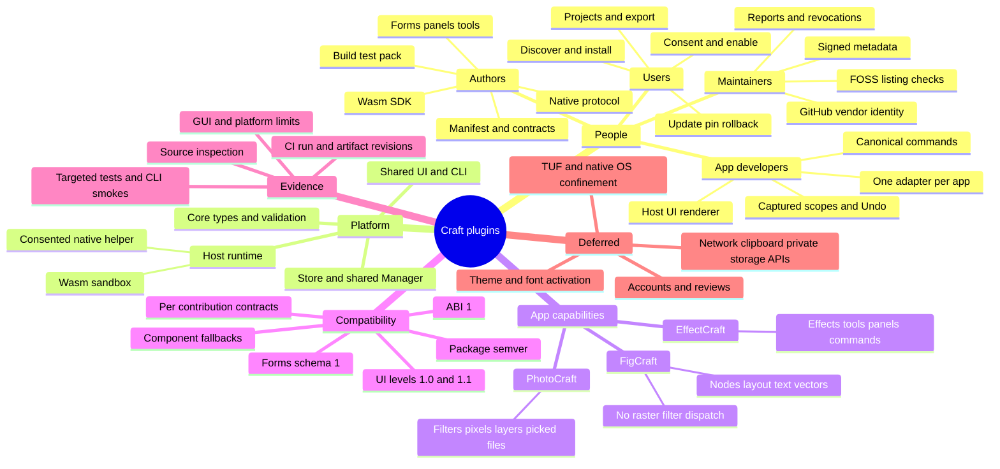
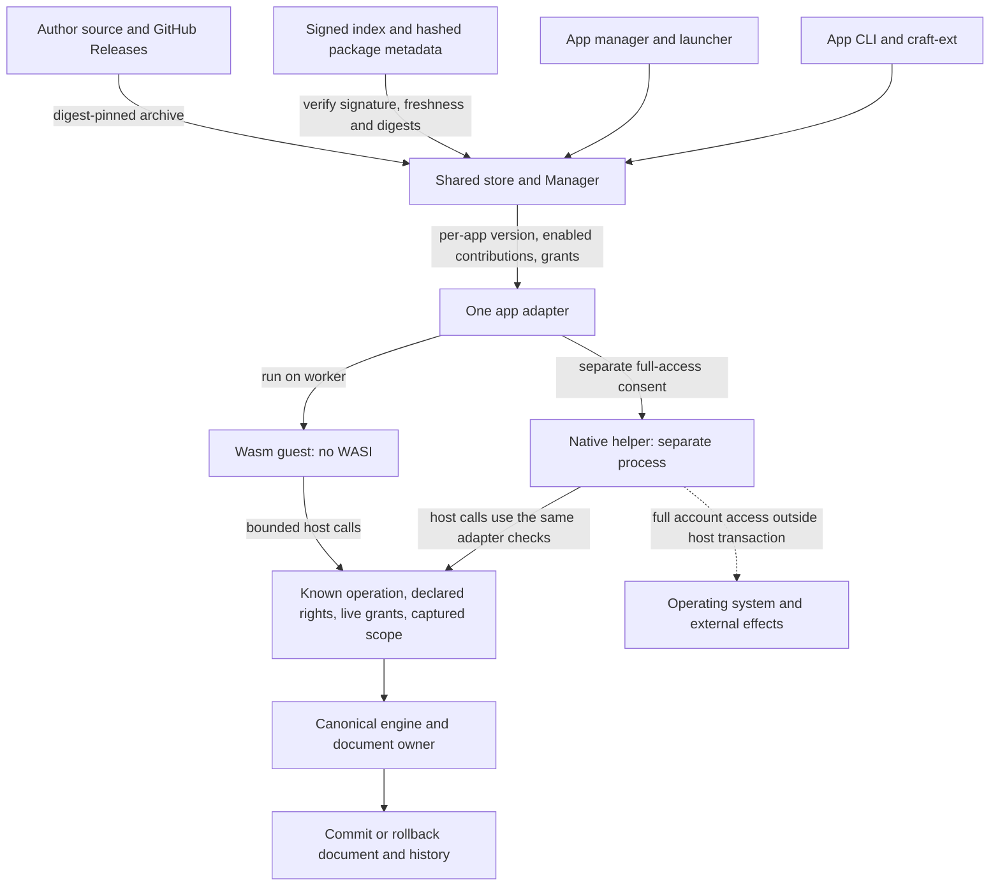
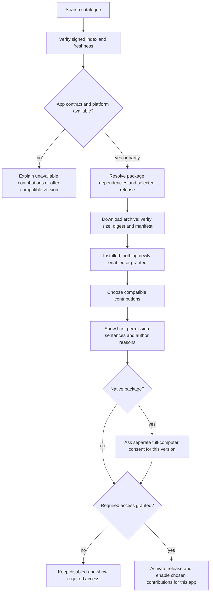
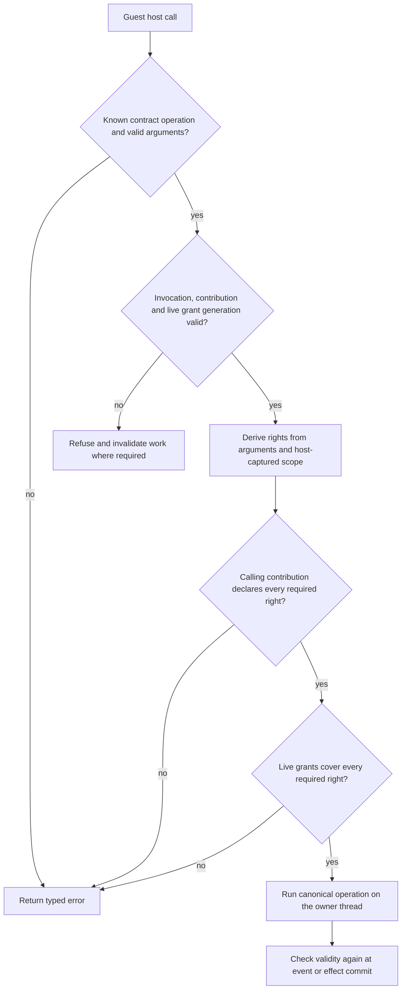
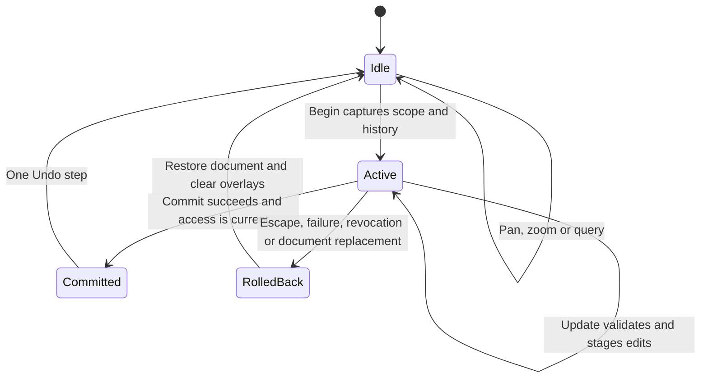
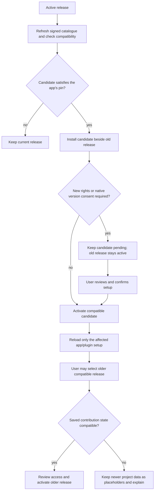
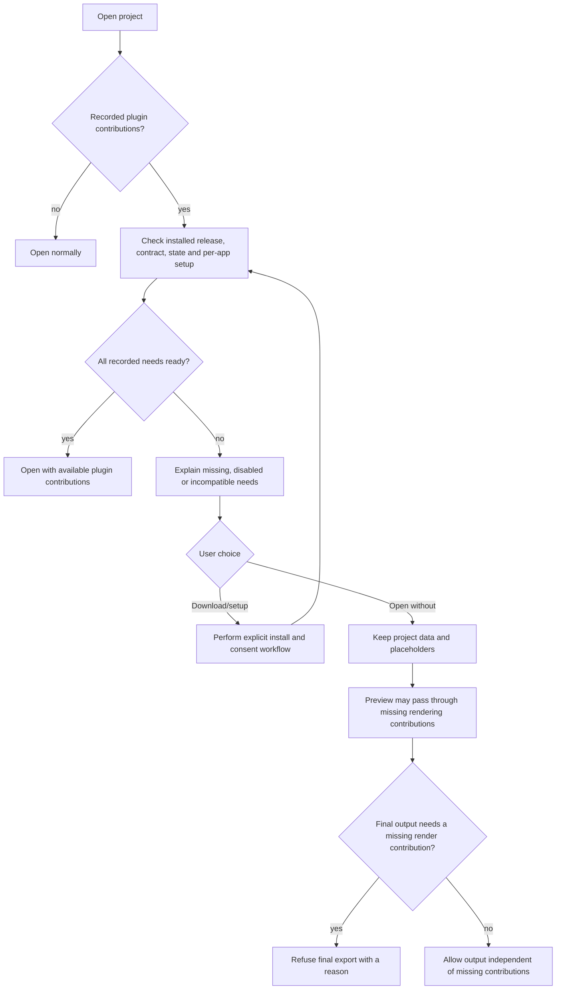
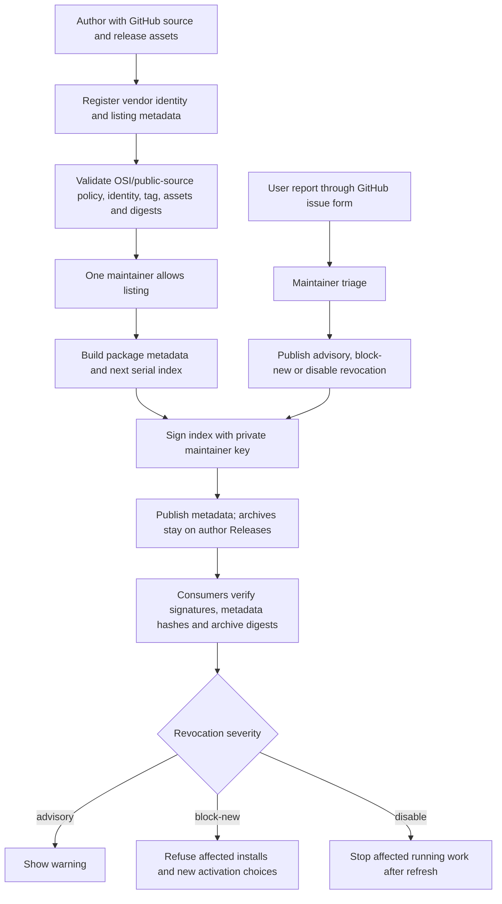

# Plugin system maps and workflows

These diagrams describe the current beta. They are editable Mermaid source, so
GitHub can render them beside the documentation. The [interactive overview](maps/overview.html)
is a self-contained companion that also opens offline. Runtime evidence and limits
are recorded in [STATUS](../../STATUS.md) and [testing](../../TESTING.md).

## Read by role

| Your task | Start | Detailed references |
|---|---|---|
| Use and manage plugins | [User guide](user-guide.md) | [Capabilities](capabilities.md), [test walkthrough](../../TESTING.md) |
| Make a plugin | [Author guide](author-guide.md) | [CLI](cli-reference.md), [UI](ui.md), [native protocol](native-protocol.md) |
| Support plugins in an app | [Adapter guide](adapter-guide.md) | [Architecture explanation](how-it-works.md), [framework handoff](framework-integration.md) |
| Publish or maintain listings | [Store and distribution](store-and-distribution.md) | [Maintainer guide](maintainer-guide.md), [catalogue procedures](https://github.com/arnav-hiwarkar/craft-plugins/blob/main/MAINTAINERS.md) |
| Find a feature or its limits | [Coverage matrix](coverage.md) | [EffectCraft contract](contracts/effectcraft.md), [PhotoCraft contract](contracts/photocraft.md), [FigCraft contract](contracts/figcraft.md) |

App and catalogue source links point to the private beta GitHub forks. The
[maintainer guide](maintainer-guide.md) links the catalogue policy and procedures.

## 1. Mind map



Vocabulary is not implementation: a permission spelling or a manifest kind does
not mean an app implements the corresponding operation. Consult the app contract.
Native full access can reach the operating system independently; it is not a Wasm
permission or a promise of additional host operations.

## 2. Ownership and trust boundaries



Source owners: `crates/ext-core`, `crates/ext-store`, `crates/ext-host`,
`crates/ext-ui`, `crates/ext-cli`, `crates/guest`, and each app's `crates/plugins`.
See [how it works](how-it-works.md#components).

## 3. Discover, install and consent



Installing a dependency does not grant its permissions. A partly compatible package
can expose usable contributions while naming the others and their reasons.
An optional permission is not silently granted. Native consent is per version.
See [user setup](user-guide.md) and [CLI setup](cli-reference.md).

## 4. One session event and one Undo step

```mermaid
sequenceDiagram
    participant User as User or app event
    participant Adapter as App adapter
    participant Worker as Guest worker
    participant Owner as Document owner
    participant Engine as Canonical engine
    User->>Adapter: Command, tool or current UI event
    Adapter->>Worker: Event plus captured invocation
    Worker->>Owner: Begin
    Owner->>Owner: Check live access and captured scope; open group
    Owner-->>Worker: Begin accepted
    loop Host operations
        Worker->>Owner: Call operation with bounded arguments
        Owner->>Owner: Validate invocation and authorize
        Owner->>Engine: Execute allowed canonical operation
        Engine-->>Owner: Result or recoverable operation error
        Owner-->>Worker: Typed result or error
    end
    Worker->>Owner: Finish with commit intent
    alt Successful event and still valid
        Owner->>Owner: Publish allowed staged files with validity checks
        Owner->>Owner: Final validation; commit document and history
        Owner->>Owner: Publish staged UI and overlays
        Owner-->>Worker: Finish accepted after finalization
    else Failure, cancellation, stale scope or revoked access
        Owner->>Owner: Roll back document, history and staged UI
        Owner-->>Worker: Finish failed
    end
```

File publication applies to PhotoCraft's picked-file operations. It precedes
accepting its document/UI commit. A later failure can leave earlier files on disk;
external effects are not covered by document Undo. Native helper activity outside
host calls has the same external-effect limitation. One recoverable operation
error may be handled by the guest; it does not by itself imply event failure.

Tool events share a gesture-wide group, so several successful updates still make
one Undo step. See [adapter transactions](adapter-guide.md#4-transactions-one-event-one-undo-step).

## 5. Host-call authorization



Guest flags cannot reduce permission requirements. A broad document edit grant
can cover narrower read/edit scope, but the calling contribution must still declare
its requirements. Unknown operation IDs never become arbitrary CLI dispatch.
See [permissions](how-it-works.md#permissions-are-checked-on-every-host-call).

## 6. Shared UI and future framework

```mermaid
sequenceDiagram
    participant Guest as Plugin
    participant Owner as App owner
    participant UI as Shared renderer
    participant Framework as Host framework or egui fallback
    Guest->>Owner: Panel/window tree
    Owner->>Owner: Validate whole tree at declared UI level
    Owner->>Owner: Stage tree; publish on successful event commit
    Owner->>UI: Surface key, current revision and tree
    UI->>Framework: Draw host-owned controls and component fallbacks
    Framework-->>UI: Stable widget IDs and typed values
    UI-->>Owner: Events tagged with surface and drawn revision
    Owner->>Owner: Reject closed/stale/unauthorized replies
    Owner->>Guest: Current UI event
```

The plugin never selects or detects the rendering backend. The host installs the
framework runtime, aligns its egui revision and controls theme selection. Existing
UI 1.0 trees remain supported; named components require usable fallbacks.
Theme activation remains deferred. See [UI reference](ui.md) and
[framework integration](framework-integration.md).

## 7. Tool gesture lifecycle



While a gesture owns document edits, unrelated edit commands must be refused.
Navigation and queries remain available. Closing a surface or replacing a document
cannot deliver stale edits. See [tools and overlays](adapter-guide.md#8-panels-windows-tools-and-overlays).

## 8. Updates, pins and rollback



A version choice does not erase newer project data or bypass access checks.
Opaque per-instance state migration is not implemented for EffectCraft.
See [version management](user-guide.md) and [store lifecycle](how-it-works.md#lifecycle).

## 9. Opening a project with missing plugins



Opening a project does not silently download, enable or grant. EffectCraft and
FigCraft use project prompts. PhotoCraft currently bakes filters into pixels and
records no corresponding plugin requirements, so it has no missing-filter prompt.

## 10. Catalogue publication and revocation



Installation requires no Craft account. GitHub identity is used for vendor
registration and report submission. App accounts, reviews and ratings are deferred;
there is no implemented review-login workflow. The local test catalogue uses a
separate public test-key override limited to debug builds and file URLs.
See [store and distribution](store-and-distribution.md).
