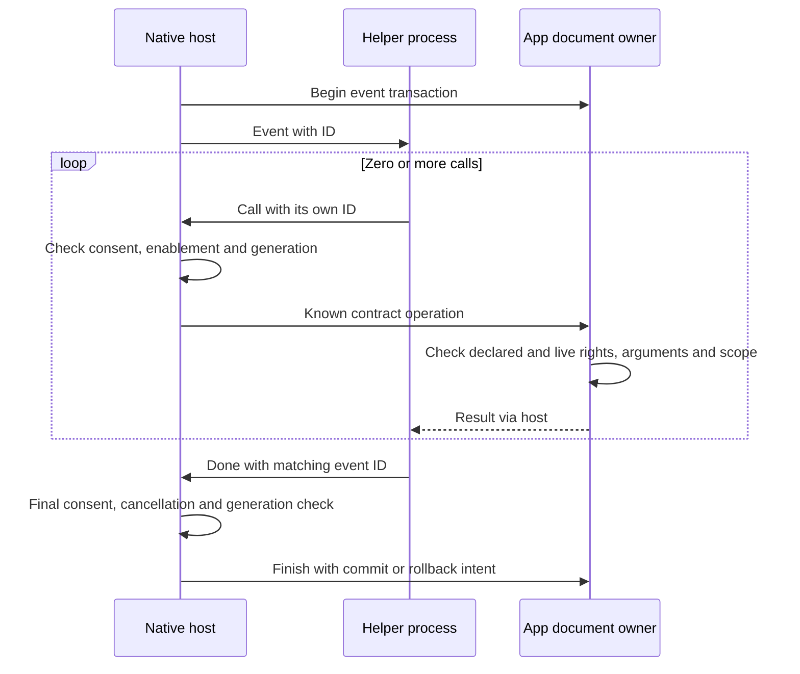

# Native helper protocol reference

This reference describes protocol 1 in `crates/ext-host/src/native.rs` and operation
errors in `crates/ext-host/src/api.rs`. For an authoring procedure, use the
[native section of the author guide](author-guide.md). For host integration, use
the [adapter guide](adapter-guide.md). The [workflow maps](maps.md) show where the
helper sits outside the Wasm sandbox.

## Execution model

A native helper is a separate executable, selected from `native.executables` by
`<os>-<arch>`. For example, an Apple Silicon helper uses `macos-aarch64`; the CI
artifact label `macos-arm64` is not a manifest platform key. The host refuses a
missing platform mapping. The executable must be present in the package at its
validated relative path.

The host starts it in a private working directory with an empty environment plus
`CRAFT_PLUGIN_PROTOCOL=1`. Standard input and output carry the protocol. Standard
error is discarded. Do not print banners or ordinary logs to standard output.
Send protocol `log` records for diagnostics. Do not depend on inherited environment
variables, credentials or a particular PATH.

A native package requires separate full-computer consent for its active version.
Its adapter host calls still need the calling contribution's declared permissions
and live grants. Outside those calls the executable has the user's ordinary OS
access. The process boundary, private working directory and cleared environment
are not an OS sandbox.

## Record format

Every record is UTF-8 JSON followed by a newline. Each record is an object with a
`type`. Flush output after each response. The host caps its reads of helper output
at 1 MiB and buffers at most 64 incoming records. These are inbound limits, not a
promise that every host result is at most 1 MiB. Helpers must bound their own input
and handle the documented result sizes of operations they call.

### Host to helper

| Type | Fields | Meaning |
|---|---|---|
| `hello` | `protocol`, `app`, `contracts` | Startup greeting; `protocol` is 1, contracts are `[name, level]` pairs. |
| `event` | `id`, `event` | One event to execute. `id` is the host event sequence number. |
| `result` | `id`, `ok` | Successful reply to a helper `call`; `ok` is the operation's JSON result. |
| `result` | `id`, `error` | Failed operation; `error` has numeric `error` and text `message`. |

### Helper to host

| Type | Fields | Meaning |
|---|---|---|
| `ready` | none required | Complete the startup handshake. |
| `call` | `id`, `op`, `args` | Invoke a known app-contract operation. The host echoes the call ID in its result. |
| `log` | `level`, `text` | Diagnostic record; numeric level is clamped to 0 through 3. |
| `done` | `id`, `code`, optional `message` | Finish the current event. The ID must match that event; code 0 requests success, nonzero reports failure. |

The host accepts calls while it is processing an event. A helper should use distinct
call IDs and match each result before using it. Event IDs and call IDs are separate
sequences. An operation error can be handled by the helper before it sends `done`.

## Example exchange

This simplified greeting shows one provided contract. A real host sends its full
provided-contract list. Each line below is a separate record, in chronological
order; the text outside the fences identifies the sender.

Host:

```json
{"type":"hello","protocol":1,"app":"effectcraft","contracts":[["effectcraft.session","1.1"]]}
```

Helper:

```json
{"type":"ready"}
```

Host:

```json
{"type":"event","id":1,"event":{"event":"command","id":"hello"}}
```

Helper:

```json
{"type":"call","id":11,"op":"ui.notify","args":{"message":"Hello from a native helper"}}
```

Host:

```json
{"type":"result","id":11,"ok":null}
```

Helper:

```json
{"type":"done","id":1,"code":0}
```

A failed operation response has this exact nested error shape:

```json
{"type":"result","id":11,"error":{"error":-2,"message":"Permission denied"}}
```

## Event finalization



A successful `done` is necessary but does not override a final host or adapter
refusal. Document/history/UI finalization remains the adapter's responsibility.
The helper cannot directly commit a document or issue protected Undo, settings,
plugin-management or arbitrary CLI operations through `call`.

Because native code has full OS access, it can launch external programs under the
user account. That is an external effect, not a new host API and not covered by the
app's Undo history. Use canonical host operations for live document edits.

## Error codes

These codes describe host operation errors, not the consumer CLI's process exit codes.
See the [CLI reference](cli-reference.md#exit-codes) for those.

| Code | Meaning |
|---|---|
| `-1` | Invalid input |
| `-2` | Permission denied |
| `-3` | Operation or target not found |
| `-4` | Stale scope or busy owner |
| `-5` | Cancelled |
| `-6` | Budget exceeded |
| `-7` | Internal error |

## Timeouts and shutdown

- Startup must return `ready` within 10 seconds.
- The native protocol event loop has a 60-second deadline. The app's document-owner
  transaction and invocation deadlines may be shorter; protocol time is not an
  extension of the app's transaction budget.
- The host checks full-access consent, stopped state, grant generation and
  cancellation before events, around calls and before accepting the event result.
- Adapters supervise idle helpers at least once per second. Revocation or a stopped
  plugin terminates the helper even while it is idle.
- A stop, protocol timeout or pipe trap causes helper termination. A nonzero `done`
  rolls the event back. Other adapter error handling follows its runtime policy;
  do not depend on a process surviving an error or on a dispose event arriving.
- On Unix the helper starts in its own process group. Stopping it kills the group
  before the child is reaped. A process that intentionally leaves the group is not
  confined by this mechanism. Cross-platform OS confinement remains deferred.

Killing a helper cannot reverse files already written, network traffic or other
external effects. A host crash or forced termination may skip all guest cleanup.
Make helper-side operations tolerant of retries and interrupted execution.

## Version and distribution rules

Protocol 1 is distinct from package semver, the guest Wasm ABI and per-app contracts.
A helper must not infer app operation availability from the app's marketing version.
Use the greeting's contracts and the app capability reference. Platform executables
must be real builds for their declared OS and architecture; renaming a Linux binary
does not make it a Mac binary.

Build, check and package procedures are in the [author guide](author-guide.md).
Source examples are under `examples/native-system-stamp`; the verified CI package
contains Linux and Apple Silicon helpers. Windows helper execution is not verified
by the Windows compile check. Production listing, digest binding and signature
verification follow [store and distribution](store-and-distribution.md).
